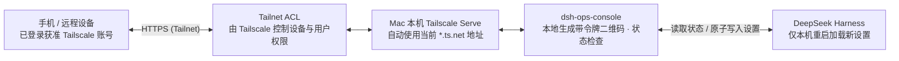

<div align="center">

# dsh-ops-console

**Mac 留在桌边，换到手机上继续用 Harness。**

DeepSeek Harness 可选远程访问插件 · Tailscale Serve · 本地二维码 · Node.js 18+

<p>
  <a href="https://www.npmjs.com/package/dsh-ops-console">npm</a> ·
  <a href="#它解决什么问题">核心能力</a> ·
  <a href="#开始使用">开始使用</a> ·
  <a href="#页面上的状态是什么意思">状态对照</a> ·
  <a href="#安全和隐私">安全和隐私</a> ·
  <a href="#更新记录">更新记录</a>
</p>

</div>

---

`dsh-ops-console` 是 DeepSeek Harness 的可选 Web 插件，入口在 **「设置 → 远程访问」**。它将 Tailscale 入口配置、连接状态检查与本地生成的登录二维码整合在一起，让你无需手动拼接命令或配置域名即可在手机或另一台电脑上继续使用 Harness。

> [!IMPORTANT]
> 它不会把 Harness 默认公开到互联网。正常使用方式是：Mac 和手机都连接到获准访问的 Tailscale 网络（tailnet），再通过二维码或 HTTPS 地址打开 Harness。所有开启与关闭入口的管理操作**仅限 Mac 本机**执行。

## 访问链路



## 它解决什么问题

远程打开 Harness，真正麻烦的往往不是得到一个网址，而是确认 **Tailscale 是否已连接、Harness 是否已生效、关闭入口会不会误伤其他服务**。`dsh-ops` 专注于四件事：

- **准备入口**：为 Harness 创建 Tailscale Serve 入口并自动配置当前 Tailscale 地址；若 HTTPS 根地址已被其他服务占用则立即停止，不直接覆盖。
- **扫码打开**：展示就绪状态、本机生成的二维码（无第三方接口外传）和可复制地址；扫码为远程设备建立 30 天 Harness 浏览器会话。
- **断点续设**：如果 Serve 入口已创建但 Harness 配置尚未保存成功，点「继续完成设置」即可补齐，无需先关闭重来。
- **公网风险告警**：检测到直接指向 Harness 的 Tailscale Funnel 公网配置时显示警告并暂停展示常规扫码入口，不擅自修改其他服务。

> [!NOTE]
> `dsh-ops` 有意不做引擎生命周期管理：它不会安装、更新、重启或恢复 Harness，也不读取余额、日志、API Key、提示词或会话正文。这些本机能力由 [dsh-desktop](https://github.com/wendyltan/dsh-desktop) 负责。

## 开始使用

开始前请确认这台 Mac 已有可用的 `dsh` Web profile、**Node.js 18+**，并已安装且登录 **Tailscale**。

### 1. 安装插件

```bash
# 推荐从 npm 安装
dsh plugin --profile web add dsh-ops-console

# 或安装 GitHub 版本
dsh plugin --profile web add github:wendyltan/dsh-ops-console

# 本地开发安装源码目录
dsh plugin --profile web add /path/to/dsh-ops-console
```

安装后**重新启动** `dsh` Web 服务（使用 `dsh-desktop` 请在客户端重启服务；仅刷新网页不会加载新插件），进入 **「设置 → 远程访问」**。

### 2. 在 Mac 上准备远程入口

点击 **「设置远程访问」**，`dsh-ops` 会为 Harness 创建 Tailscale Serve 入口并写入当前 Tailscale 地址，无需填写自定义域名：

- 若 HTTPS 根地址已被其他服务占用，操作会停止并提示冲突。
- 若提示 **「入口已创建，Harness 设置尚未完成」**，检查配置目录权限后点击 **「继续完成设置」**（仅补齐缺失设置）。
- 若提示 **「Harness 等待重启」**，必须重启 Harness 服务，仅刷新网页不会生效。

### 3. 扫码打开

入口就绪后，在已加入同一 tailnet 且具备访问权限的手机或电脑上扫码，或复制页面上的登录地址打开。二维码包含本次启动的登录令牌，可帮助新设备或 cookie 失效的设备直接建立 30 天浏览器会话。

> [!WARNING]
> **扫码会建立 Harness 浏览器会话，但不会改变 Tailscale 权限。** 二维码中的登录令牌属于 bearer 凭据，请勿将本机扫码页面截图外传；令牌仅下发给 Mac 本机页面，并随 `dsh` Web 重启轮换。

## 谁能做什么

| 能力 | Mac 本机 | Tailscale 远程设备 |
|---|---|---|
| 查看入口状态与复制登录地址 | 可以 | 可查看状态；带令牌的登录地址仅在 Mac 本机生成 |
| 开启或关闭远程入口 | 可以 | 不可以 |
| 更新、重启或恢复引擎 | 不属于 `dsh-ops` | 不属于 `dsh-ops` |

关闭远程访问时，`dsh-ops` **仅移除 Harness 自己的 Serve 入口**，不执行全局 `tailscale serve reset`，不会误删其他服务的 Serve 配置。若设备丢失，请在 Tailscale 后台撤销该设备或调整 ACL。

## 页面上的状态是什么意思

| 页面状态 | 发生了什么 | 你可以怎么做 |
|---|---|---|
| `Tailscale 未连接` | 应用未运行、未登录或离线 | 在 Mac 上打开并登录 Tailscale |
| `入口未创建` | 尚未为 Harness 配置 Serve | 在 Mac 本机点击「设置远程访问」 |
| `Harness 设置未完成` | 入口已创建，但自动保存设置未成功 | 检查目录权限后点击「继续完成设置」 |
| `Harness 等待重启` | 远程设置已保存，Harness 尚未载入 | 重新启动 Harness 服务（仅刷新网页无效） |
| `远程入口已开启` | Mac 端三项配置全部就绪 | 用已接入 tailnet 的设备扫码或复制地址打开 |
| `请检查公网访问配置` | 检测到直接指向 Harness 的 Funnel 公网配置 | 在 Mac 上核查并关闭对应入口的 Funnel |
| `无法确认 Funnel 配置` | 状态读取失败或配置无法识别 | 检查本机 Tailscale；切勿把「未知」当作「安全」 |

> [!TIP]
> 点击「检测连接」会从 Mac 本机验证远程 HTTPS 地址连通性；即使本机代理将 `*.ts.net` 解析为 fake-ip，插件也会自动改用 Mac 的 Tailscale IP 直连并保留 SNI/证书校验。但本机通过不代表手机端一定可达，最终以另一台设备实际打开为准。

## 安全和隐私

- **三重本机校验**：开启和关闭入口同时要求同源请求、Mac 本机访问和本机管理令牌。
- **本机生成二维码**：使用 MIT 许可的本地编码器直接生成，不调用任何外部二维码 API。
- **最小暴露健康接口**：公共健康接口仅返回插件可用性与版本号，不暴露 PID、端口、引擎版本或本机路径。
- **配置安全落盘**：自动写入 Tailscale 地址前最多保留 5 份配置备份，并采用同步落盘与原子替换。
- **Funnel 探测边界**：依据 Tailscale 的 [Serve 配置定义](https://github.com/tailscale/tailscale/blob/main/ipn/serve.go) 只读检查直接指向 Harness 的 HTTP/TCP 转发与前台配置；「未发现」不覆盖路由器端口映射或其他反向代理，不构成完整安全审计。

<details>
<summary>常见问题解答（FAQ）</summary>

- **需要购买域名吗？** 不需要。插件直接使用这台 Mac 的 Tailscale 地址（`*.ts.net`），不提供自定义域名映射。
- **手机可以开关远程入口吗？** 不可以。管理操作与含令牌地址仅在 Mac 本机开放。
- **为什么没有设备授权列表或确认码？** 设备与人员权限统一由 Tailscale ACL 管理，避免维护第二套容易造成误解的记录。
- **看到二维码就表示手机一定能连上吗？** 不表示。手机仍需已连接 Tailscale 且满足 ACL 权限。

</details>

## 更新记录

### 0.7.3

- 「检测连接」在域名解析被本机代理接管（如 `*.ts.net` 被解析成 fake-ip）时，自动改用 Mac 的 Tailscale IP 直连并保留 SNI/Host 与证书校验，不再误报失败。
- 直连验证成功时明确提示：本机浏览器直访域名可能仍受代理影响，远程手机不受影响。

<details>
<summary>历史版本更新（0.7.2 / 0.7.1）</summary>

#### 0.7.2

- 二维码携带本次启动的登录令牌：新设备或手机 cookie 失效后扫码不再落到 `401`。
- 登录令牌仅通过 Mac 本机管理接口下发，并随 `dsh` Web 重启轮换。
- 页面在本机管理令牌就绪后自动刷新二维码，避免首次打开短暂缺码。

#### 0.7.1

- 移除手动增删访问域名的界面和接口，保留当前 Tailscale 地址的自动设置。
- 修复部分设置失败后缺少继续入口的问题，重试仅补齐缺失设置。
- 新增针对 Harness 的 Funnel 公网配置警告；读取失败时显示未知状态，不误报安全。
- 明确区分「需要重启服务」与「刷新网页」。

</details>

## 开发与发布

运行完整验证套件（覆盖语法、权限边界、路由契约、页面状态、失败重试、隔离 Funnel 配置与临时 `dsh` Web 启动）：

```bash
npm test
```

本机受保护开发环境部署（普通用户无需运行）：

```bash
node scripts/deploy.mjs
```

发布前可使用 `npm pack --dry-run` 检查入包文件；仓库已配置 GitHub Trusted Publishing 工作流（需在 npm 包设置中配置可信发布者）。

## 许可

[MIT](LICENSE)
